# 1. 全体像

## 何をするものか

**CAD 図面(DXF)↔ ゲーム用 3D アセット**の双方向変換です(講義[第 0 回](../lecture/00-introduction.md))。

## 3 つのルート(`parse_dxf` が自動判定)

| ルート | 入力の見た目 | 処理 |
|---|---|---|
| **A** | 2D の図面(線・円) | 三面図を作り、押し出しのフォールバック + **GPU 推論**(Zero123++ / TripoSR)で外観を作る |
| **B** | 3D の **POLYFACE MESH**(メッシュそのもの) | メッシュを直接取り出し、**推論をスキップ**して後処理 |
| **C** | **建築の平面図**(壁・建具のレイヤー) | レイヤー分類 → 端点スナップ → 壁厚の推定 → 開口を切る → **押し出し** → 屋根・テクスチャ(任意で外観の推論) |

逆向き(**3D → 図面**)は `mesh_to_dxf`(Z バッファで隠線判定 → 三面図 + 平面図)。

## 1 回の流れ(ルート C)

```mermaid
%%{init: {"theme":"base","fontFamily":"Noto Sans JP, Hiragino Sans, Meiryo, sans-serif","themeVariables":{"fontFamily":"Noto Sans JP, Hiragino Sans, Meiryo, sans-serif","primaryColor":"#ffffff","primaryBorderColor":"#d0d5dd","primaryTextColor":"#101828","lineColor":"#667085","clusterBkg":"#f2f4f7","clusterBorder":"#d0d5dd","edgeLabelBackground":"#ffffff"},"flowchart":{"wrappingWidth":480,"nodeSpacing":40,"rankSpacing":56,"padding":14},"sequence":{"mirrorActors":false,"wrap":false,"width":150,"actorMargin":30,"messageMargin":34}}}%%
flowchart LR
    A[DXF] --> B[parse_dxf<br/>単位・レイヤー・ルート判定]
    B --> C[レイヤー分類<br/>壁・建具・家具・階段・無視]
    C --> D[端点スナップ<br/>KD 木 + Union-Find]
    D --> E[壁厚の推定・重複の除去]
    E --> F[壁を押し出す<br/>開口を切る・床・天井]
    F --> G[屋根 / テクスチャ]
    G --> H[postprocess<br/>修復・LOD・glTF]
```

## 入口

| 入口 | 場所 | 用途 |
|---|---|---|
| CLI | `cli.py`(`run` / `export` / `info`) | 手元での変換・書き出し・図面の情報 |
| REST API | `api.py`(FastAPI) | `POST /convert`(202)→ `GET /jobs/{id}` → `GET /jobs/{id}/download/{LOD}`。ジョブは**メモリ**・TTL と上限あり |
| 逆変換 | `core/mesh_to_dxf.py` | メッシュ → 三面図 + 平面図の DXF |
| 補助 | `fbx2obj.py` | FBX → OBJ(Blender 経由) |

## 状態の置き場所

| 何を | どこに |
|---|---|
| API のジョブ | **メモリ**(`_JOBS`)。`MAX_JOBS`(500)・`JOB_TTL_SEC`(3600)で掃除 |
| ジョブの作業フォルダ | `WORK_DIR/<job_id>/`(アップロードした DXF・中間・出力) |
| 出力 | `out/`・LOD ごとの glTF / OBJ・三面図の PNG |
| 計測ベースライン | `tests/baseline.json`(`tests/bench.py` の出力) |

## 設定(主なもの)

| 名前 | 既定 | 意味 |
|---|---|---|
| `MAX_JOBS`・`JOB_TTL_SEC`・`JOB_TIMEOUT_SEC` | 500・3600・(コード参照) | API のジョブの上限・保持・時間切れ |
| `ExtrusionConfig` | 階高 2500mm・壁厚 150mm・スナップ 80mm ほか | 押し出し(講義第 1 回) |
| `RoofConfig` | 切妻・棟 1.5m・軒の出 0.3m | 屋根 |
| GPU | RTX 3070(8.6GB)で確認 | 推論(Zero123++・TripoSR) |
